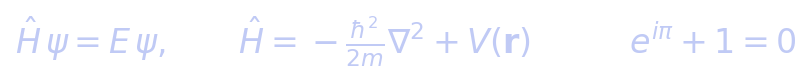

# @azarai/pi-math

Render LaTeX math as **inline images in the [pi](https://pi.dev) chat transcript**.

When the model calls the `math` tool, the formula is typeset to a transparent
PNG and displayed right in the conversation in terminals with image support
(**Kitty**, iTerm2, Ghostty, WezTerm). Formula color adapts to your terminal
theme automatically.



## Features

- **Inline rendering** — formulas appear in the chat via the Kitty graphics
  protocol (and equivalents), as part of the `math` tool result block
- **Theme-adaptive color** — matches your terminal's foreground color via
  kitty remote control; falls back to a `COLORFGBG` heuristic, then white
- **Lightweight** — no LaTeX installation: rendering uses matplotlib's
  mathtext engine (a large subset of LaTeX math) through system `python3`
- **Model-invoked** — ask *"show me this formula"* in natural language and
  the model typesets it

## Install

```bash
pi install npm:@azarai/pi-math
```

Then just ask, e.g. *"render the Gaussian integral"*, or explicitly
*"use the math tool to show E = mc²"*.

## Prerequisites

- `python3` with `matplotlib` (`pip install matplotlib`); set `PI_MATH_PYTHON`
  to use another interpreter
- A terminal with image support (Kitty, iTerm2, Ghostty, WezTerm) for inline
  display; in other terminals the tool still works, the image is simply not
  shown inline

## Tool parameters

| Parameter | Type | Description |
|-----------|------|-------------|
| `latex` | string | LaTeX/mathtext source, without `$` delimiters |
| `color` | string? | `'auto'` (default), or any CSS/hex color |

## License

MIT
